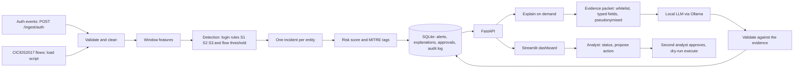

# SOC Alert Triage Assistant

[](https://github.com/abhinavsesh/soc-triage-assistant/actions)

A local prototype that turns authentication events and network-flow data into prioritised, explainable security alerts. Each alert carries a transparent risk score, MITRE ATT&CK tags, an optional AI explanation that is checked against the evidence, and a dashboard where analysts update status and propose response actions that a second analyst must approve.

**Status:** prototype built on lab data and a small synthetic log. It shows a method and an engineering approach. It is not validated for production use.

## What it does
- Ingests batches of authentication events through a REST API and detects three scenarios: brute force, password spraying, and success after failures from a new IP.
- Detects flow-level brute force (FTP and SSH) on the CICIDS2017 Tuesday file with a per-service threshold.
- Groups detections into one incident per entity, scores them (additive, with a per-signal breakdown) and tags them with ATT&CK techniques labelled as hypotheses.
- Stores alerts, explanations, approvals and an audit log in SQLite.
- Generates a plain-language explanation with a local model (Ollama), after sanitising and pseudonymising the evidence, and validates the output against that evidence.
- Streamlit dashboard: ranked alert table, evidence, explanation, status changes, action proposals, four-eyes approval, history.

## What it deliberately does not do
- The model never detects, scores or acts. It can only explain and propose.
- Nothing changes a real system. Approved actions run as a dry run that writes a log line.
- Isolation Forest is evaluated in `scripts/` and compared with the rule baseline, but no ML model is served in the live path. The rule had no false positives on this data (see Results).

## Architecture



## Data
- **CICIDS2017, Tuesday file:** real labelled flows with FTP-Patator and SSH-Patator brute force from a single scripted source. Not included in this repository (size and licence). Download it from the Canadian Institute for Cybersecurity and place it at `data/raw/tuesday.csv`. Use the version with IP addresses and timestamps.
- **Synthetic auth log (`data/sample/auth_sample.csv`):** 18 rows with three hand-written stories. Real labelled login data with usernames is rare. This file demonstrates the logic and is not evidence of real-world accuracy.
- CICIDS2017 timestamps have no AM/PM marker, so afternoon times can appear 12 hours early.

## Results (window level, lab data)
| Detector | Setup | Precision | Recall |
|---|---|---|---|
| Rule, threshold = 2 x benign maximum | Per service, 5-fold CV, FTP | 1.00 | 0.984 |
| Rule, threshold = 2 x benign maximum | Per service, 5-fold CV, SSH | 1.00 | 1.00 |
| Isolation Forest, benign baseline, 99th percentile | Per service, 5-fold CV, FTP | 0.926 | 1.00 |
| Isolation Forest, benign baseline, 99th percentile | Per service, 5-fold CV, SSH | 0.913 | 1.00 |

What failed first, and what it taught:
- A single threshold tuned on FTP gave 47 false positives on SSH (precision 0.57), because each service has its own normal.
- An Isolation Forest fitted on FTP and tested on SSH ranked worse than random (ROC-AUC 0.373). Baselines and thresholds must be per service.

Caveats: one scripted attacker and one source IP, random cross-validation folds that leak neighbouring minutes, and labels used to choose the benign baseline rows. Treat these numbers as an optimistic comparison between methods, not a performance claim. Details are in `docs/evaluation_notes.md`.

## Security design
Everything from logs is treated as untrusted. Layers: field whitelist, typed-field validation, sanitising, pseudonymisation, delimited evidence, validated JSON output, no tools that write, and human approval for any action. Full threat table and residual risks in `docs/security_review.md`.

## Quick start
Python 3.13 was used. The explanation feature needs [Ollama](https://ollama.com) with a pulled model; everything else works without it.

```bash
python3 -m venv .venv && source .venv/bin/activate
python -m pip install -r requirements.txt
python -m pip install -e .
cp .env.example .env
# put two API keys into .env, one per analyst (key:name pairs):
python -c "import secrets; print(secrets.token_urlsafe(24))"
# ANALYST_KEYS=<key1>:analyst_1,<key2>:analyst_2

python scripts/load_alerts.py
python -m uvicorn soc_triage.api.main:app --port 8000
python -m streamlit run src/soc_triage/dashboard/app.py   # in a second terminal
ollama pull llama3.1:8b && ollama serve                    # optional, for explanations
python -m pytest -q
```

Interactive API docs are at `http://127.0.0.1:8000/docs`. Use `python -m uvicorn`, not a bare `uvicorn`, so the virtual environment's Python is used.

## Demo walkthrough
1. Sign in as `analyst_1`. Open the highest-risk alert and read the evidence, the score breakdown and the MITRE hypotheses.
2. Generate an explanation (20 to 40 seconds with a local model). Note the validation badge and its wording.
3. Move the alert to `investigating`. Try an invalid move and read the refusal.
4. Propose `block_ip`. Note that `analyst_1` has no approve button for it.
5. In a second browser tab, sign in as `analyst_2`, approve, then execute. The result is a dry run, and the History tab shows each step with the analyst's name.

## API summary
| Method and path | Purpose |
|---|---|
| POST /ingest/auth | Analyse a batch of auth events and store alerts |
| GET /alerts, GET /alerts/{id} | Ranked list with filters, and full detail |
| PATCH /alerts/{id}/status | Status change with allowed transitions |
| POST /alerts/{id}/explain | Local-model explanation, cached |
| POST /alerts/{id}/actions, GET /actions | Propose and list response actions |
| POST /actions/{id}/decision | A different human approves or rejects |
| POST /actions/{id}/execute | Dry run of an approved action |

## Project layout
```
src/soc_triage/
  ingestion/   CSV loading and cleaning
  features/    time-window features
  detection/   rules, incidents, evaluation, Isolation Forest (experiments)
  scoring/     risk score and alert builder
  mitre/       ATT&CK mapping
  llm/         evidence packet, pseudonymisation, prompt, client, validator
  agent/       read-only tools, tool runner, approval gate
  api/         FastAPI app, schemas, authentication, SQLite storage
  dashboard/   Streamlit app and API client
scripts/       experiments and utilities
docs/          design notes, evaluation, security review
tests/
```

## Limitations
- Lab and synthetic data. A slow, distributed or low-volume attack would evade the current rules.
- Each ingest batch is analysed on its own. Events are not stored, and the new-IP baseline comes from that batch.
- The flow baseline uses labels to find benign windows. In production it would come from a known-clean period.
- The AI explanation is a draft. The validator checks consistency with the evidence, not correctness, and it was tested on a handful of cases with one small local model.
- Demo-grade authentication: static keys, no HTTPS, no rotation or rate limiting.
- SQLite and a Streamlit front end are for local use. Production needs Postgres, SSO and a proper front end.
- MCP was studied at concept level only. No MCP server was built.
- No Docker image or live monitoring. A plan is in `docs/production_readiness.md`.

## Tests and CI
113 tests cover features, detection, scoring, the evidence and validation layers, the tools and approval gate, the API (including hostile input and four-eyes approval) and the dashboard client. GitHub Actions runs them on every push.

## Acknowledgements
CICIDS2017 is from the Canadian Institute for Cybersecurity. MITRE ATT&CK and ATLAS are from MITRE.
